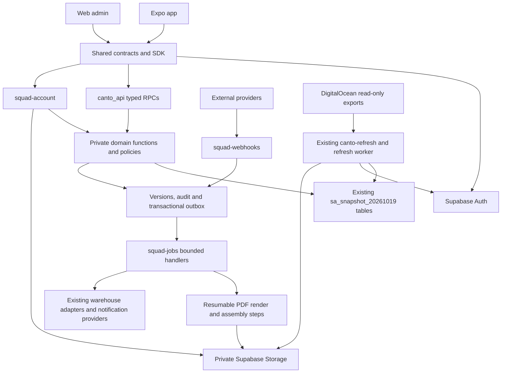

# Squad One backend rebuild: audit and implementation plan

Audit date: 7 November 2026. Status: **plan and source audit; business services are not implemented or deployed by this change.** Scott, Canto and Squad One refer to the legacy application/rebuild in this document. Printing Tracker is the separate existing admin/warehouse application.

Execution is now tracked separately in [SQUAD_ONE_EXECUTION.md](SQUAD_ONE_EXECUTION.md), including verified slices and evidence-based updates to this original plan. In particular, the latest requirement is Supabase-only job execution, and hosted Auth access requires one narrow read-only privilege bridge. The source-audit counts below remain the approved scope, not an implementation completion claim.

Build one backend organized around **28 shared capability modules and 115 workflow rows**, with role and relationship rules applied inside those modules. **68 workflow rows serve two or more personas.** Use typed database RPCs for transactional business operations, three new Edge Function deployments for work that needs external services or privileged credentials, and the existing refresh/warehouse services. Keep the current business schema; do not create another full copy or redesign every table.

The detailed deliverable is the [functionality matrix](squad-one-audit/FUNCTIONALITY_MATRIX.md), also available as an [offline searchable table](squad-one-audit/matrix.html) and [CSV](squad-one-audit/functionality-matrix.csv). Every workflow includes its actors, conditional actors, reuse count, proposed contract, input/output fields, rules and source references. [Personas](squad-one-audit/personas.csv) and [master capabilities](squad-one-audit/master-capabilities.csv) provide the two opposite views of the same registry.

## What was audited, and what the evidence proves

The user selected **local Flutter `develop`** as the source of truth. These are pinned source baselines, not an assertion about the exact binary installed on every customer's phone:

| Source | Baseline | Treatment |
|---|---|---|
| Flutter | `5d55d9461af18b94a867dce07dee7c4b76f1e51f`, local `origin/develop`, 25 July 2026 | Approved app baseline |
| Flutter main | `eef6bffd82e25f730cf325b59990f9b4f8026dd6`, 3 May 2025 | Older comparison only; do not accidentally rebuild it |
| Rails | `14277820c78e018e62be3da1a14cd8d716cdbf02`, main, 30 September 2026 | Core server implementation baseline |
| Rails alternate develop | `058ffb160c323ca329aea2228af8b92477275a3c`, 28 September 2026 | Include WMS/dashboard adapter and webhook behavior in the scope; flag differences |
| Supabase | Existing `sa_snapshot_20261019`, staging column inventory and read-only environment checks | Actual imported structure; 86 business/framework tables |
| Printing Tracker | Existing Masters, Auth isolation, warehouse APIs, refresh and media code | Reuse boundaries, not new implementations |

The original GitHub repositories were unavailable to the connected accounts. Local cached sources were readable; the user expressly accepted local Flutter develop. Both branches were compared. No production business rows were modified during this audit.

| Coverage ledger | Count | Interpretation |
|---|---:|---|
| Flutter Dart source files | 647 | `lib/`, including models, widgets and generated/support code |
| Rails source/config/template/task files | 811 | `app/`, routes, jobs configuration, schema, 296 migrations, token helper and rake tasks |
| Flutter view/support files | 317 | Includes view models and tab files, not 317 unique screens |
| Flutter service method declarations | 146 | Includes notification/client-only helpers; not 146 backend endpoints |
| Rails controller methods | 444 | Includes private helpers |
| Route declarations expanded statically | 468 | Includes duplicate resources and PATCH/PUT pairs |
| Unique verb/path routes | 461 | 374 have a method in the pinned controller source |
| Declared route entries without a handler | 87 | Primarily scaffold `new/edit` and unused resources; not 87 missing product requirements |
| Migration-history files | 296 | Structural/data migrations inventoried as provenance; never replayed on Supabase |
| Alternate-branch methods | 123 | Warehouse/webhook differences indexed with pinned evidence |
| Branch-difference entries | 333 | 299 Flutter application changes, 34 Rails changes within the inventory scope |
| Notification strategy types | 115 | Consolidate into events, recipient rules and templates |
| Job source files | 13 | 12 concrete jobs plus framework base |
| Callback/enqueue/email/push call sites | 111 | Side-effect audit input, not unique domain events |
| Checked-in Rails schema tables / imported tables | 71 / 86 | Checked-in schema is stale; source models/migrations/live inventory must be reconciled |

Every inventory entry has a module/support/retirement disposition; the validator reports zero unclassified entries. This is **source classification coverage**, not proof that every role's runtime behavior has passed. The static route parser covers the DSL in this pinned routes file; it does not boot Rails or inventory third-party Sidekiq UI internals. Native packaging, store binaries and asset-file contents are outside this backend audit. Source fingerprints allow future changes to be detected without restarting discovery.

## Personas and reusable functionality

The backend stores 13 roles with stable numeric IDs. The Flutter login router exposes 11 dashboards. `Tailor` falls back to login, and `SubTailor` is absent from the Flutter enum. Both are managed workforce records in the evidenced workflows. Flutter's additional `CustomerCoordinator` enum has no matching backend role or dashboard; it must not become an invented fourteenth persona.

| ID | Persona | Existing core functionality | Reused master modules |
|---:|---|---|---|
| 0 | Admin | People/persona administration, customer approval, SC/PC management, products, notes, roles/goals, targets, promotions, catalogue generation, Airtable sync, coordinator changes, order search/force-close | AUTH, PEOPLE, LINK, CAT, CONFIG, PRICE, ORDER, TASK, GOAL, TARGET, METRIC, DOC, PROMO, INTEGRATE |
| 1 | Sales Coordinator | Assigned customers/dealers, product configuration, quotes, orders and edits, payment status, price overrides, prime flag, targets, notes, responsibilities, ratings | Shared people/catalogue/order/commercial/work modules |
| 2 | Production Coordinator | Custom production orders, factories, SC/customer oversight, factory/job-worker allocation, criteria, worker costs, production metrics, notes/goals/ratings | ORDER, PEOPLE, PLAN, JOB, METRIC, TASK, GOAL, RATE |
| 3 | Customer | Registration/onboarding, products/configuration, own orders, coordinator request, catalogue/share/promotions, feedback, profile | AUTH, LINK, CAT, CONFIG, PRICE, ORDER, DOC, PROMO, RATE |
| 4 | Factory Manager | Assigned orders, cutting allocation, tailor/sub-tailor setup, job sheets, delivery, notes, work reports | PEOPLE, ORDER, PLAN, CUT, SEW, DISPATCH, TASK, METRIC, DOC |
| 5 | Tailor | Managed assignments, production quantities, team, earnings and rankings; no working standalone dashboard evidenced | Subject of PEOPLE, SEW, METRIC, DOC |
| 6 | SubTailor | Managed member of tailor team; allocation/completion/reporting subject | Subject of PEOPLE, SEW, METRIC, DOC |
| 7 | Dispatch Incharge | Factory dispatch queue, partial dispatch, destination, delivery/challan, tailor work visibility | DISPATCH, SEW, PEOPLE, DOC, METRIC |
| 8 | Inspector | Factory job sheets, inspect/complete/pick quantities, tailor visibility | SEW, PEOPLE, METRIC |
| 9 | Cutting Master | Assigned cutting queue, size-level cutting, progress/history | CUT, METRIC |
| 10 | Dealer | Own purchase orders, linked customer orders/customer creation, dealer stock, dispatch, back orders, products/catalogues/promotions | PEOPLE, LINK, CAT, CONFIG, ORDER, STOCK, BACK, DISPATCH, DOC, PROMO |
| 11 | Job Worker | Assigned production orders, six-stage progress, due-date reasons; configurable products/notes/goals | ORDER, JOB, METRIC plus conditional CAT, CONFIG, DOC, TASK, GOAL, PROMO |
| 12 | Assistant Worker / “Team” | Configurable products, notes and responsibilities/goals; no invented order-management dashboard | Conditional CAT, CONFIG, DOC, TASK, GOAL, PROMO |

Auth/session, app shell, media and notification infrastructure are shared across the 11 mobile actors. The matrix includes proposed consistency improvements explicitly, such as self-profile support for Admin/Team; it does not present them as existing screen parity.

Printing Tracker's authenticated administrator is a **separate principal**, marked `P` in the registry, and is not automatically equivalent to legacy Admin role 0. Master CRUD and refresh currently use that existing admin boundary. Do not give all legacy admins unrestricted access to Printing Tracker's `public` data.

For Job Worker/Team, map the existing feature keys to server-owned capabilities: `1` notes, `2` roles/goals, `3` product tab, `3.2` catalogue download/markup, `3.3` custom configuration/cost breakdown, `3.4` promotional assets. Product browsing does not imply order creation. An enabled child capability must also satisfy its parent and business relationship scope. Counts in the matrix include conditional use; they are not unconditional grants.

## Architecture decision

The recommended boundary is a **modular backend in one Supabase project per environment**, not 28 separate deployed services. A module is a code/policy ownership boundary; a workflow row is a business capability; neither equals an Edge deployment.



### Three new Edge deployments

| Deployment | Endpoints/handlers | Why this boundary |
|---|---|---|
| `squad-account` | `/register`, `/confirm`, `/recovery`, `/users/invite`, `/users/status`, `/media/grants`, `/media/uploads`; support-session route disabled until policy is implemented | User-facing orchestration that needs Auth admin/Storage/provider credentials. Each route has its own authentication, authorization and rate policy. Ordinary password login uses Supabase Auth directly. |
| `squad-webhooks` | `/warehouse/:provider`, with typed order/stock event handlers | Provider-authenticated ingress; raw-body signatures, replay protection and durable acceptance. No browser session trust. |
| `squad-jobs` | Internal dispatch for email, push, external order/customer synchronization, reconciliation and bounded maintenance | Service-only queue consumer; never accepts arbitrary actor IDs from users or an arbitrary handler URL. |

Keep existing `canto-refresh`, `dashboard-stock-api`, `uniware-bridge` and admin/printing functions. **Three new deployments does not mean the entire Supabase project will have only three functions.** Do not consolidate unrelated existing functions merely to improve a count.

Supabase supports routing multiple endpoints within a function and shared code between functions. Its guidance also points data-intensive operations toward database functions. The split above follows trust and execution requirements rather than one function per persona. [Supabase development guidance](https://supabase.com/docs/guides/functions/development-tips).

Implementation amendment, 8 November: the user's requirement that business execution stay on Supabase supersedes the original Cloud Run worker proposal. Iteration 26 uses the existing `squad-jobs` deployment with durable database leases, immutable inputs, bounded PDF parts and a separate assembly step. It has passed staging acceptance for a 101-class catalogue and eleven synthetic 1.96-megapixel PNGs; these are tested workloads, not an unlimited rendering guarantee. Import/export workers remain a separate implementation gate. Hosted Edge CPU/memory limits still apply; increasing wall time is not a substitute for bounding CPU work. See [document contracts and limits](squad-one-audit/DOCUMENT_IMPLEMENTATION.md) and [Edge limits](https://supabase.com/docs/guides/functions/limits). Existing GitHub refresh execution remains separate and unchanged.

### RPCs versus direct data access

The Supabase Data API is an HTTP API, not a raw database connection embedded in the app. Direct table reads can be safe with appropriate privileges, RLS and field exposure. RPC/Edge is not automatically safer or faster just because there is another layer. [Securing the Data API](https://supabase.com/docs/guides/api/securing-your-api).

For this application, **RPC-first is the right default**: orders, quantities, stock and permissions span multiple tables and need atomic operations. Use one typed RPC per query/transactional command, not per role. Do not send ordinary reads through an Edge proxy before the same database query. Multiple small, typed RPCs are preferable to one enormous `action` switch that accepts arbitrary fields. The existing allowlisted Masters dispatcher is a deliberate limited exception, not a model for arbitrary business mutations. [Database functions](https://supabase.com/docs/guides/database/functions).

## Database and access design

Keep all 86 imported tables in `sa_snapshot_20261019` with their `sa_` prefixes. Preserve legacy IDs and existing relationships. Continue using `sa_identity` for Auth UUID reservations and `sa_sync` for refresh ownership/progress. Existing `sa_admin` remains the guarded Masters implementation.

Add a small private `sa_domain` schema for domain helper functions and **only new operational records**: entity revisions, idempotency records, audit events, outbox/jobs, immutable quote snapshots, document jobs and provider event receipts. Reuse existing equivalents where their contracts fit. This is not a second business schema or a remapping copy of customers/orders/products. Index and constraint changes are selective and measured.

Expose typed `canto_api.v1_*` RPCs, extending the current API schema. Keep the imported tables and private helpers out of exposed schema lists. Do not add raw SQL or generic table/path execution endpoints. [Custom schema access](https://supabase.com/docs/guides/api/using-custom-schemas).

The imported tables currently deny `sa_app` table access. Preserve that boundary. Proposed command execution:

1. The exposed wrapper is `SECURITY INVOKER`, with explicit `EXECUTE` grants only to approved callers.
2. It calls a narrow private domain function, owned by a dedicated `NOLOGIN NOBYPASSRLS` execution role. That role has only required table privileges and is not the table owner.
3. Where elevation is necessary, the private function is `SECURITY DEFINER`, uses a fixed `pg_catalog` search path and schema-qualified names, validates the live actor/session and resource relationship, and runs under explicit RLS policies. It must not be owned by the default bypass-RLS superuser role.
4. Revoke default `PUBLIC` execute privileges; grant only the needed private function/schema access. Never expose the private schema through REST/GraphQL. Force RLS on protected tables as defense in depth; verify helpers do not introduce policy recursion.
5. Ordinary read functions can remain invoker functions when the chosen execution path supplies the required safe privileges. Do not add table grants to `sa_app` merely to silence permission errors.

This is intentionally more explicit than saying “use RLS.” The caller's role is `sa_app`; blindly writing policies only `TO authenticated` will fail or authorize the wrong population. User-editable metadata never grants access. Resolve Auth UUID through the existing identity reservation, then read current legacy role, disabled/deleted/approval state and relationships. For sensitive calls, check current session validity; JWT role claims alone can remain stale after a refresh/revocation.

One reusable policy function computes resource scope, and each command adds action/field/state rules. An order read and an order edit share ownership logic but have different permissions. Prices, worker costs, fabric consumption, factory identity, email/phone/address and feedback need explicit field projections; hiding a widget is not protection. Raw user records must never return password/reset hashes, tokens or device secrets.

### Refresh compatibility is a prerequisite

The existing refresh validates the destination schema/index/grant/trigger fingerprint. Adding RLS policies, indexes or domain hooks requires a **reviewed baseline update** for each environment, not disabling drift checks. Initial restore also runs `protect_schema`, which revokes imported-table grants. The API execution-role installation must be deterministic after bootstrap and validated after every refresh.

Refresh runs must not emit historical order emails, re-reserve stock, generate old PDFs or replay customer notifications. Do not attach external side effects directly to imported row triggers. Commands enqueue domain events explicitly, using an unforgeable server execution path; import publication does not execute those commands. Derived summaries may be rebuilt intentionally after import with `origin=import` and no outbound deliveries.

The current refresh intentionally replaces target-side business edits and Auth password/email/role changes with source values. **A writable new app and unrestricted source refresh cannot coexist safely.** Before real users write, extend the existing edit-revision guard to all domain/Auth/media writes and introduce an environment write epoch:

| Mode | Allowed behavior |
|---|---|
| Mirror | DigitalOcean owns data. New app reads; disposable staging test writes require explicit discard/reconciliation before refresh. New-system password changes are also fenced. |
| Cutover preparation | Freeze old-system business writes through an operational cutover window; capture final source, reconcile all tables/Auth/media, establish new sequence high-water marks. No DigitalOcean code changes are required by this plan. |
| New-system ownership | Supabase owns business/Auth writes. Old-source refresh button is disabled for owned data; an old export can be compared offline, not automatically overwrite the new system. |

Start with environment-wide cutover to keep it simple. Do not introduce per-row bidirectional synchronization. Module-level ownership can be a later deliberate project if necessary. After new real writes, rollback means replay/reconcile those writes; restoring an old snapshot alone would lose them. Production/staging have independent epochs, credentials, workers, buckets and source mappings.

Refresh never writes Printing Tracker `public` tables. Normal warehouse operations may legitimately affect the existing warehouse through its established API; that is different from refresh copying or overwriting `public`.

## Important legacy behavior to preserve

These are the details most likely to be lost in a superficial rebuild. The matrix links them to contract IDs.

| Area | Required behavior |
|---|---|
| Authentication | Preserve existing eligible users' UUID/password compatibility. Disabled/deleted/explicitly unapproved users denied; legacy null approval remains distinct. No migration email. Case-colliding emails remain explicit exceptions, not silently merged accounts. |
| Customer onboarding | Self, SC and dealer-created flows differ. Dealer-created linked customers are auto-approved/onboarded; manual verification endpoint is Admin/SC only. Approval, onboarding, confirmation, direct-deal and coordinator assignment are distinct states. |
| Relationships | Customer/dealer links, authorized brands, primary city/zone, price type, stock visibility percentage and direct-deal conversion affect routing and pricing. Coordinator reassignment must update intended current ownership without rewriting completed history. |
| Custom configuration | Base types/categories, fabric UOM/GSM, adult/kids consumption, parts/add-ons/colors, print/embroidery, dimensions, reference artwork, sample orders, size quantities and extra quantities. Canonical preset comparison excludes artwork in the source. |
| Pricing | Sample or quantity below six uses sample rate. Otherwise fabric + OF/SN + trims + add-on costs, overhead and quantity margin; legacy unit rounding is three decimals. Tax uses state/threshold/SKU-rate branches. Preserve tested calculation behavior as versioned policy; finance must validate rates, not treat old hardcoded values as law. |
| Orders | Custom, RMP and mixed; customer, dealer and SC-on-behalf placement; pure RMP dealer-brand splitting; manual payment fields; prime/due dates; quantities; edits; cancellation versus deletion; force completion. |
| Production | Factory and job-worker paths; criteria readiness; cutting-master allocation; partial cutting; tailor/team job sheets by size/date; inspection/pick/completion histories; partial dispatch. |
| Job workers | Six explicit stage values, per-piece costs, assigned due date versus requested date and reason/delta, visibility flags and efficiency. |
| Dealer stock | Own purchase receipts versus linked customer consumption; RMP matching and canonical custom matching; availability versus display percentage; bulk back-order links and shortage calculation. |
| Completion | Mixed order requires dispatch and external completion; custom/dealer-linked dispatch completion; pure RMP provider status. Cutting, stitching, dispatch, criteria, worker stage and order completion remain separate dimensions. |
| Tasks/goals | Creator/assignee notes, deadlines, order links, assignment changes and status alerts; responsibilities have role/goal/task kinds; Team is an eligible responsibility subject even though backend enum is incomplete. |
| Performance | Current/past/year SC targets, placed versus completed totals, ratings and averages, operational summaries, factory/tailor rankings and weekly reports. |
| Documents | Catalogue selection/exclusion, company/bank/address/terms, fixed/% markup, stock flag, direct download or email, lifecycle history; delivery challans and weekly tailor work/payment PDFs. |
| Media | Migrated files and new uploads share resource authorization. Explicit missing-file states; external links remain external. No production recovery for staging missing files. |
| Notifications | Event recipients differ by actor, customer/dealer route and production state. Multi-device FCM, foreground/background/deep links, in-app history; task/rating alerts outside the 115-strategy factory also matter. |
| Configuration | Version/force-update checks, optional Airtable master imports, CSV price uploads/status, zone import, reports and provider selection. |

### State and transaction rules

| Command family | Lock/check | Single transaction | After commit |
|---|---|---|---|
| Place/edit order | Actor scope, quote revision/expiry, idempotency, order revision | Order(s), items, quantities, child links, audit and outbox | Provider submission/customer sync, notifications, report updates |
| Allocate/cut/inspect | Same factory, active assignment, bounded remaining size quantity | Quantity history, rollup, revision, audit and event | Notifications and derived metrics |
| Dispatch | Eligible item, remaining quantity, dealer stock sources | Dispatch rows, local consumption allocations, state rollup and event | External fulfillment and document generation |
| Cancel | Allowed actor, completion/external state, current revision | Local cancel intent and reservation-release intent | Provider cancellation/release; show pending/error until reconciled |
| Worker stage/due | Assigned worker or privileged scoped correction | Stage/date history, reason, version and event | Targeted notifications and efficiency refresh |
| Customer reassignment | Current coordinator/request, relationship validity | Links and intended pending-order ownership, audit | Notifications/target recomputation |
| Task/goal transition | Creator/assignee/subject, allowed transition | State/member changes and outbox | Recipient-specific alerts |
| Import/refresh | Environment lock, schema baseline, write epoch | Existing atomic publication and Auth reconciliation | Explicit derived rebuild/media reporting, never user-event replay |

Use row locks in deterministic key order, unique keys and checked quantities; optimistic revision alone is insufficient for concurrent stock or production consumption. Do not keep a database transaction open across provider HTTP calls. Multi-system workflows use an outbox and explicit compensating actions.

For worker stages, allow forward progress within the documented chain; backward correction requires PC authority and reason. For production quantities, append corrections with provenance rather than rewriting totals invisibly. Order status is derived; a generic status setter must not bypass quantity/provider invariants. Preserve legacy canceled orders in historical lists but label cancellation rather than counting them as successfully fulfilled.

## Contracts and shared packages

The [matrix](squad-one-audit/FUNCTIONALITY_MATRIX.md) names every planned query/command. The [RPC catalogue](squad-one-audit/api-catalog.csv) currently contains 115 distinct proposed names; these are SQL interfaces, not 115 Edge deployments. The count may shrink when closely related read projections share a contract, but transaction boundaries and authorization clarity take priority over a cosmetic minimum. These are **proposed interfaces**, not already callable endpoints. Use typed inputs with explicit unknown-field rejection; JSON may carry nested items but must be schema validated.

Common contract rules:

- Preserve legacy bigint IDs as decimal strings in JavaScript/JSON; Auth IDs remain UUIDs. Decimal money/rates are strings backed by Postgres `numeric`, never binary floating-point authority.
- Server derives actor and environment. A client-selected customer/factory is a requested resource context and must be authorized; never accept `acting_user_id` as identity.
- Mutations carry an idempotency UUID where retry could duplicate work. Store actor + operation + key + normalized payload hash + committed result. Same key/different payload fails. Retain stock/order dedupe evidence for the business lifetime, not just a short HTTP timeout.
- Existing-entity commands carry `expected_version`. Use a sidecar revision record where modifying imported columns would unnecessarily alter source schema. Test concurrent create/update/delete and refresh races.
- List queries use bounded cursor pagination, deterministic tie-break ID, capped page size (default 25, maximum 100). Report totals come from shared aggregate queries; clients never fetch every row to calculate counts.
- Return data plus `request_id`, `data_revision`, `as_of` and pagination metadata where relevant. Job responses return job ID/state/progress, not a fake success while work is pending.
- Stable errors: `UNAUTHENTICATED`, `ACCOUNT_INELIGIBLE`, `FORBIDDEN`, `NOT_FOUND`, `VALIDATION`, `VERSION_CONFLICT`, `IDEMPOTENCY_CONFLICT`, `QUOTE_EXPIRED`, `INSUFFICIENT_STOCK`, `INVALID_TRANSITION`, `REFRESH_LOCKED`, `PROVIDER_UNAVAILABLE`. Avoid resource enumeration by unauthorized callers.

Example command/result shapes:

```json
{
  "quote_id": "uuid",
  "quote_revision": 4,
  "customer_id": "123",
  "delivery_address_id": "456",
  "due_on": "2026-11-20",
  "idempotency_key": "uuid"
}
```

```json
{
  "data": {"order_ids": ["901", "902"], "total": "12500.00", "currency": "INR", "provider_sync": "queued"},
  "meta": {"request_id": "uuid", "data_revision": 18}
}
```

```json
{
  "item_id": "501",
  "expected_version": 7,
  "quantities": [{"quantity_id": "711", "quantity": 3}],
  "performed_on": "2026-11-07",
  "idempotency_key": "uuid"
}
```

Use `packages/contracts` for validators, error/type definitions and capability names; `packages/sdk` for Auth/RPC/Edge calls and query keys; `packages/domain` only for pure shared formatting/validation/calculation fixtures. SQL is the authority for transactional state. Never maintain independent client and server pricing formulas. Client preview can use returned quote breakdown or a clearly non-authoritative cached estimate.

Keep `apps/admin` and `apps/mobile` as consumers of those packages. Existing shared environment definitions remain authoritative. The eventual UI reuses person editors, order lists/details, product browser/configurator, production queues, task views and job-status components; role configuration changes actions/fields/scope. This plan does not build those screens yet.

## Existing integrations and environment differences

Read-only imported settings on the audit date:

| Setting | Staging | Production |
|---|---|---|
| `airtable_sync_enabled` | `false` | `false` |
| `use_dashboard` | `true` | No row returned |

The alternate Rails develop branch contains `WmsRouter` and Dashboard adapters, plus signed order/stock webhook controllers. Main does not contain the same complete set. The staging snapshot contains dashboard-related order fields. These facts establish that both integration paths belong in the plan; they do **not** prove which exact server commit is deployed or that an absent production setting overrides every environment variable. Capture actual adapter/provider health during staging implementation; production remains read-only until release.

Reuse existing `dashboard-stock-api` snapshot/reserve/release/fulfill/adjust/order contracts and `uniware-bridge`. Preserve one authority for stock in each facility. Business order intent and external warehouse fulfillment are separate records linked by durable IDs. API retries must not create a second external order. Webhooks verify the raw body, enforce environment/signature/timestamp, persist a provider event ID before acknowledgment, and reject out-of-order regressions. Scheduled reconciliation handles missed events.

The stock-change webhook in the alternate Rails branch logs events and contains a TODO. The plan includes actual cache/availability invalidation; it is not represented as a fully working old feature. Existing order webhook handling intentionally ignores the initial `CREATED` race; preserve that intent while adding durable event ordering.

## Findings and intentional corrections

| Finding | Evidence | Rebuild decision |
|---|---|---|
| Stale checked-in schema | [Table inventories](squad-one-audit/snapshot-tables.csv) versus [Rails schema inventory](squad-one-audit/legacy-tables.csv) | Use live imported columns plus pinned models/migrations; 16 live-only tables and one schema-only notification-history table |
| Client-only access rules | [Literal role rules](squad-one-audit/legacy-role-rules.csv); controllers often trust supplied IDs | Server-authoritative action + relationship + field checks; test direct API calls |
| Identity compatibility exceptions | [Auth sync notes](../tools/canto-sync/README.md#authentication-sync) | Keep conflicting email identities in an exception workflow; never claim every stored row is login eligible |
| Hardcoded privileged credentials/master-password path | Flutter auth/product-service and legacy auth source | Never port embedded credentials or universal-password bypass; values omitted from all audit artifacts |
| Price authority in Flutter | `lib/app/calculator.dart`; `check_item_prices_service.rb` | Server quote and controlled SC override; golden fixtures for formulas/rounding |
| Dealer stock allocation arithmetic | `update_used_stock_service.rb` | Correct `min(available,remaining)` allocation; test available=3, required=10 consumes 3, not 7 |
| Silent side-effect failures | Rails `rescue nil` and job/mail/push call sites | Durable outbox, observable retries and explicit partial provider state |
| Notification dedupe disabled in base strategy | Commented duplicate check in `notifications/base_strategy.rb` | Unique event/recipient/channel and delivery-attempt records |
| Team responsibility enum mismatch | Flutter AssistantWorker versus Rails responsibility role enum | Support Team as a subject; reject unrelated roles |
| Coordinator change updates legacy creator fields | `customer_requests_controller.rb` | Define current assignment explicitly and preserve completed-order attribution |
| Milestone overlap validation misses containment | Milestone implementation | Full interval-overlap check; concurrent exclusion/locking |
| Rating actor and role validation defects | `ratings_controller.rb` uses supplied `from_id` and `User::Types::ROLES` | Derive actor, verify work relationship, correct enum validation and update history |
| Unused/declared-only APIs and screens | [Routes](squad-one-audit/legacy-routes.csv), `no_use_*` views, older branch | Give explicit retirement/support disposition rather than invent endpoints |
| New writes conflict with mirror refresh | Existing revision guards and Auth sync ownership | Implement write epoch and cutover gate before real new-app writes |

Not every permissive legacy endpoint is a business requirement. Where the old UI and server disagree, the matrix states the proposed narrower policy and the discrepancy is tested explicitly. Preserve successful authorized workflows; do not preserve IDORs, bypass credentials or arithmetic defects as “parity.”

## Implementation sequence and completion gates

Work in vertical slices, with a progress update after each iteration: implemented behavior, tests/evidence, defects found, corrections made, remaining gate. Avoid a long period of untested scaffolding.

| Iteration | Deliverable | Exit evidence |
|---|---|---|
| 0 — scope lock | This pinned-source audit, persona matrix, contracts, discrepancies and coverage validator | Every inventoried item classified; user baseline recorded; no secret/customer exports |
| 1 — execution and access | Private domain role/schema, live actor/session guard, capability mapping, API skeleton, SDK contracts, refresh-compatible grants/baselines, write epoch | `sa_app` allowed/denied cases; public/staff isolation; refresh still succeeds without side effects |
| 2 — people and catalogue reads | Identity/profile, scoped directories, customer relationships, master-backed product discovery, promotions, media grants | Representative fixtures for all 11 actors; cross-customer/factory/dealer denial; correct field projection |
| 3 — pricing and orders | Configurator/presets, quote authority, place/edit/cancel, split orders, manual payment fields | Golden price vectors; duplicate/concurrent order tests; all split children returned; provider intent recorded atomically |
| 4 — production and stock | Assignment, criteria, cutting, job sheets, inspection, dispatch, job worker, dealer stock/back orders | Two competing writers cannot overcut/overcomplete/overdispatch/oversell; sample/mixed/dealer chains complete correctly |
| 5 — coordination and reporting | Notes/tasks, goals/responsibilities, milestones, ratings, common dashboards | Correct subject/assignee rules, historic attribution, aggregate parity and authorization |
| 6 — asynchronous services | Queue/outbox, webhook gateway, FCM/email handlers, PDF worker, imports/exports, reconciliation | Crash/retry/replay tests; PDF output/links verified; failed jobs observable; no double external orders |
| 7 — complete headless acceptance | Every workflow's allowed/denied/variation/error scenarios, one complete journey per active persona, refresh compatibility | [Acceptance matrix](squad-one-audit/ACCEPTANCE.md), contract fixtures, performance evidence, zero unresolved release blockers |
| 8 — UI handoff | Stable SDK and capability-driven view contracts, seeded staging demo personas | UI team can consume tested services without new business discovery; no production release implied |
| 9 — production cutover, separately scheduled | Same tested migrations/artifacts, final source freeze/capture, reconciliation, ownership change and monitored enablement | Table/Auth/media parity, provider selection, login checks, no data loss, rollback/reconciliation rehearsal |

No DigitalOcean application changes are planned. No real production transactional testing is needed to prove staging authorization/concurrency. Use isolated staging test records and provider sandboxes/mocks; keep notification destinations controlled.

## Performance and reliability standards

“Optimized” will mean measured results, not fewer filenames. Initial acceptance targets (to be validated on staging with representative data and documented network location): warm database execution p95 under 200 ms for bounded lists/details, under 500 ms for ordinary commands, and no per-row query loop in paginated reads. Record end-to-end API latency separately; external providers/PDF rendering are asynchronous and excluded from those database budgets.

Inspect `EXPLAIN (ANALYZE, BUFFERS)` on production-shaped staging fixtures; add indexes for actual scope/filter/join paths such as customer/coordinator/factory/worker + status + sort, relationship foreign keys, production assignment/quantity keys, and recipient/date. Partial soft-delete indexes are candidates, not blanket migrations. Audit nullable legacy fields before tightening constraints; do not silently reject imported historical data.

Use one grouped query for cards/report aggregates and keyset pagination for large lists. Materialize expensive summaries only after measurement, with an explicit refresh/invalidation contract. Cache keys include environment, identity/scope, capability/price/data revisions; never share a customer's price projection through a global cache. Private Realtime notifications should carry invalidation identifiers and require reauthorized reads, not broadcast raw sensitive rows.

Durable jobs have bounded batches, leases/visibility windows, heartbeat, backoff, dead-letter state, cancellation at safe boundaries and redacted progress. Queue delivery is not a promise of exactly-once external effects; deduplication and idempotent provider contracts are still required. [Supabase Queues](https://supabase.com/docs/guides/queues).

Before implementation deployment, pin CLI/client versions and inspect the installed CLI help. The November CLI v3 changes target selection and hosted confirmation behavior; do not blindly upgrade current scripts. PostgreSQL minor-release compatibility checks apply before new index/extension choices; custom operational objects belong outside the reserved Realtime schema. [CLI v3](https://supabase.com/changelog/supabase-cli-v3), [Postgres changes](https://supabase.com/changelog/postgres-15-19-17-11-breaking-changes), [Realtime ownership](https://supabase.com/changelog/realtime-schema-locked-down-against-modification).

## What “finished” means

For this planning milestone: the approved source baseline is pinned; all inventoried routes, methods, view files, jobs, notifications, tables and branch differences have a disposition; the shared matrix, proposed contracts, architecture and acceptance gates are reviewable and reproducible. The acceptance document defines 65 scenario groups plus individual workflow and persona coverage requirements.

For the next implementation milestone: every retained workflow has passing positive, negative, scope, state and retry tests; all 11 active personas complete their journeys; Tailor/SubTailor managed flows work; no unexplained migration discrepancy or critical security/quantity/price defect remains; and a fresh refresh cannot overwrite owned writes or replay side effects. Passing a login test alone is not business authorization acceptance.

The audit does not claim live execution of every old-app screen, proof of the deployed Rails commit, or that future source changes cannot introduce functionality. Those limits are explicit, and the fingerprint/difference ledger makes changes visible. Implementation should use this plan as the scope and fixture index, consulting the pinned evidence for details rather than repeating broad discovery.
